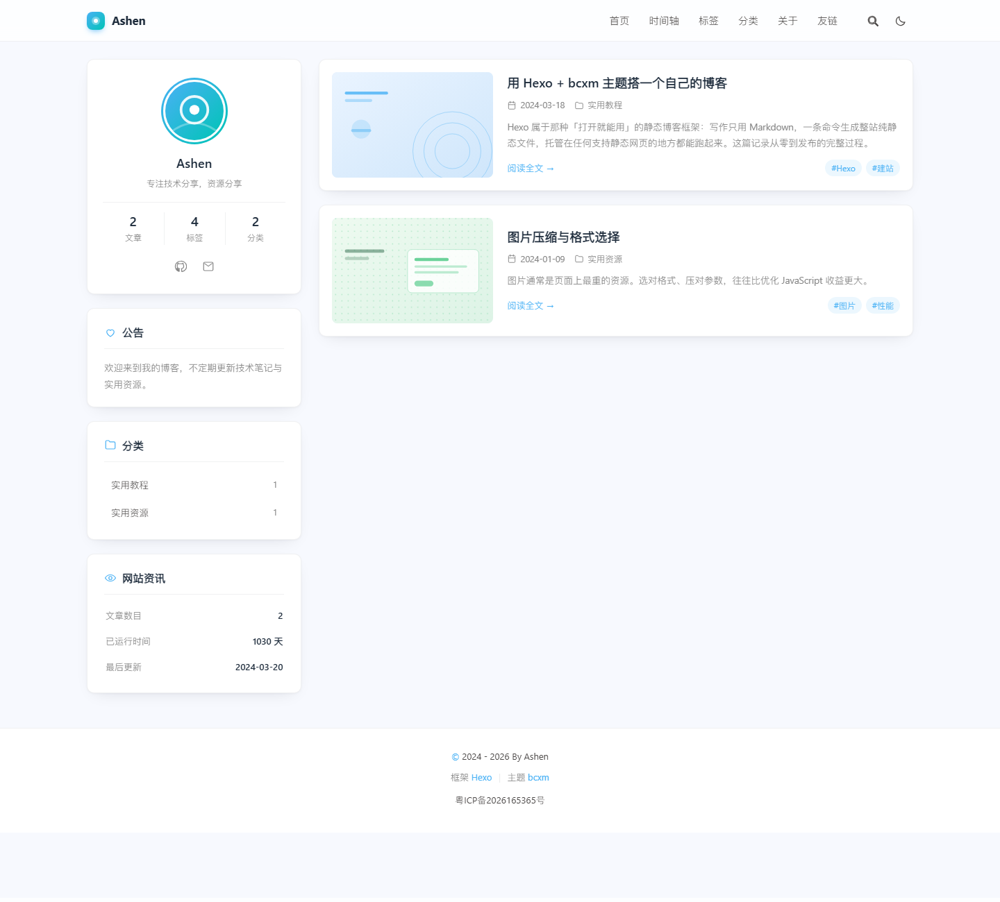
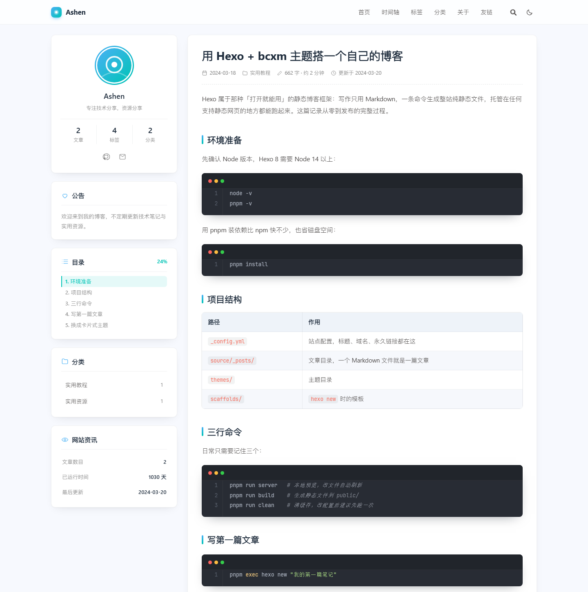
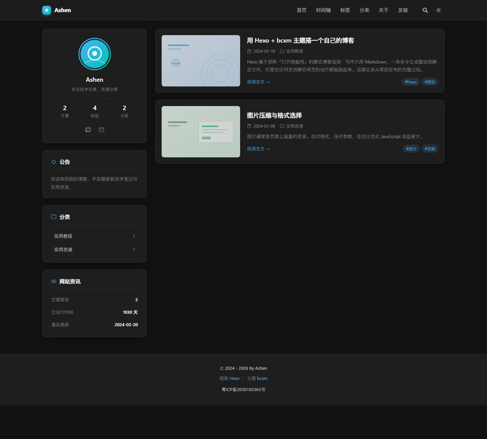
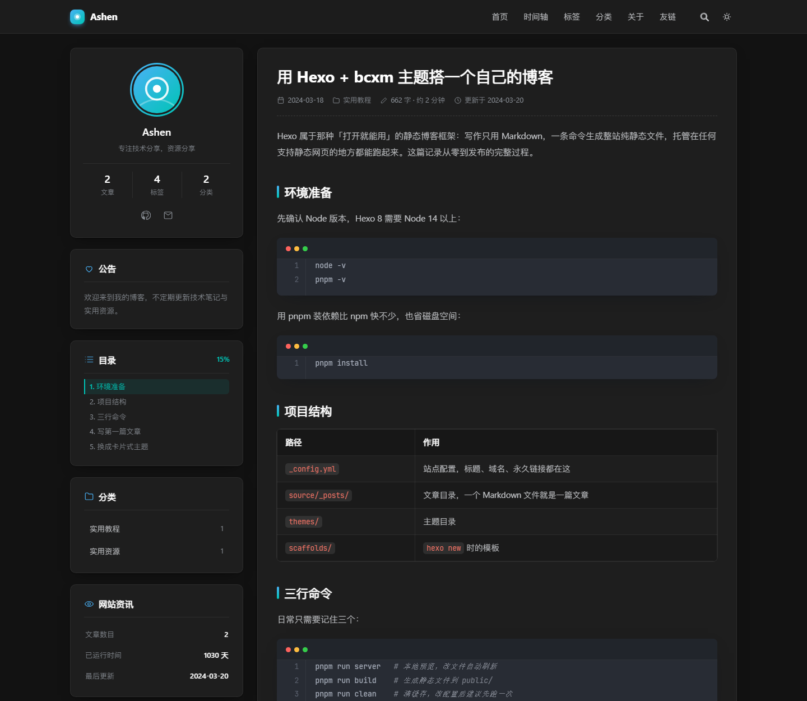
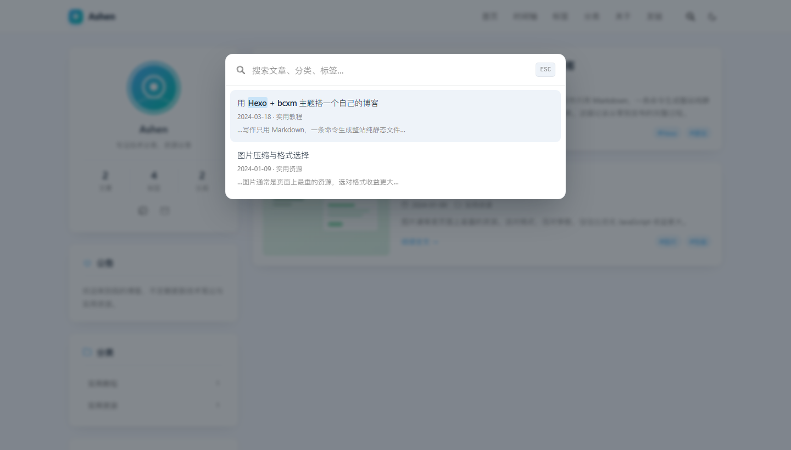
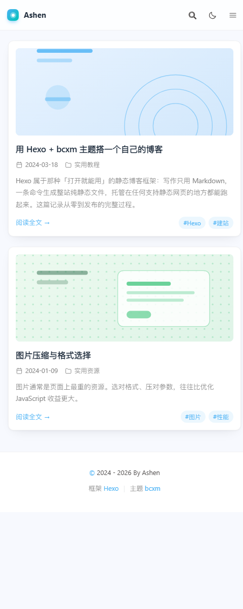
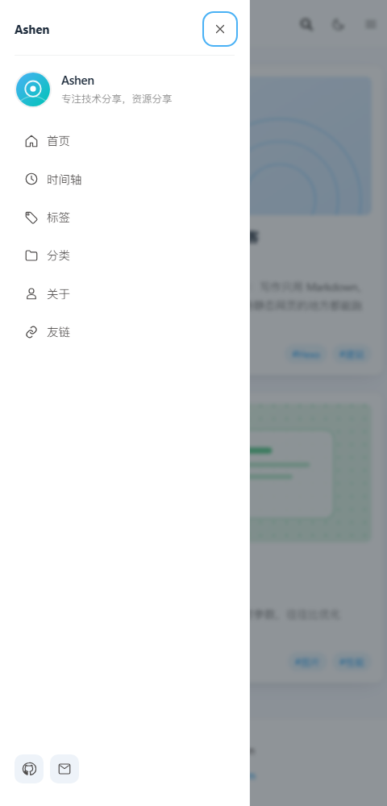

# 我的博客

基于 **Hexo 8** 的个人博客，视觉与结构参照 [bcxm.fun](https://www.bcxm.fun)（`hexo-theme-bcxm` 主题的卡片式风格）重新实现。

主题不依赖任何 CDN、不需要安装额外渲染器，只用项目里已有的 `hexo-renderer-ejs` + 原生 CSS/JS —— 离线也能正常构建和浏览。

## 预览

| 首页 | 文章页 |
| --- | --- |
|  |  |

| 深色模式（首页） | 深色模式（文章页） | 站内搜索 |
| --- | --- | --- |
|  |  |  |

| 移动端 | 抽屉菜单 |
| --- | --- |
|  |  |


## 快速开始

```bash
pnpm install      # 首次
pnpm run server   # 本地预览 http://localhost:4000
pnpm run build    # 生成静态文件到 public/
pnpm run clean    # 清缓存（改配置后建议先跑一次）
```

## 目录结构

```
blog/
├── _config.yml           站点配置：标题、域名、永久链接、分页
├── _config.bcxm.yml      主题的站点级配置：头像、导航、公告、页脚
├── package.json          脚本与依赖
├── scaffolds/            新建文章的模板
├── source/
│   ├── _posts/           文章（Markdown）
│   ├── about/            关于页
│   ├── links/            友链页
│   ├── tags/             标签总览页（type: tags）
│   ├── categories/       分类总览页（type: categories）
│   └── img/              头像、站点图标、文章封面（SVG）
└── themes/bcxm/          主题
    ├── _config.yml       主题默认配置（不建议直接改）
    ├── layout/           EJS 模板
    │   └── includes/     head / header / aside / footer / 搜索 等片段
    ├── source/css/       style.css（布局）+ post.css（正文与代码块）
    ├── source/js/        main.js（深色模式、搜索、目录、复制…）
    └── scripts/          主题助手函数与搜索索引生成器
```

## 换成你自己的信息

改这三个地方就够了：

1. **站点信息** —— `_config.yml` 顶部的 `title` / `subtitle` / `author` / `url` / `keywords`。
   上线前务必把 `url` 改成真实域名，否则 `canonical`、分享链接和版权声明里的地址都不对。
2. **主题信息** —— `_config.bcxm.yml` 里的 `avatar`、`description`、`social`、`menu`、`announcement`、`footer`（含 `footer.icp` 备案号）。
3. **内容** —— 把 `source/_posts/` 下的示例文章换成自己的，`source/img/covers/` 换成自己的封面图。

## ICP 备案

在 `_config.bcxm.yml` 里填备案号即可，页脚会自动显示并链接到工信部备案查询系统：

```yaml
footer:
  icp: '粤ICP备2026165365号'        # 留空则不显示
  icp_link: https://beian.miit.gov.cn/
```

工信部要求：备案号需在网站底部（通常是首页底部）清晰可见，并能点击跳转到 `beian.miit.gov.cn` 查询。本项目已按此实现，备案号出现在每个页面的页脚。

> 公安联网备案另有单独的图标（备案图标）要求，需要时把图标放到 `source/img/`，再用 `footer.custom_text` 插入即可。

## 导航写法

`_config.bcxm.yml` 的 `menu` 支持三种形态：

```yaml
menu:
  首页: / || home                  # 路径 || 图标名，图标可省略
  友链: /links/                    # 纯路径
  工具||tools:                      # 键名带 || 图标 = 二级菜单
    镜像站: https://example.com
    JSON 格式化: /tools/json/
```

可用图标：`home` `clock` `tag` `folder` `user` `link` `tools` `search` `github` `mail`
`twitter` `rss` `weibo` `zhihu` `music` `heart` `list` `eye` `pen` `calendar` `comment`。
需要新图标时，在 `themes/bcxm/scripts/helpers/icon.js` 的 `ICONS` 里加一条 path 即可。

## 已实现的功能

- 卡片式文章列表：封面、分类、摘要、标签
- 左侧栏：作者卡（文章/标签/分类统计）、公告、分类、网站资讯
- 文章页：目录（滚动高亮 + 阅读进度）、版权声明、上下篇、相关文章
- 时间轴归档（按年分组）、标签云、分类总览、友链网格、关于页
- 深色模式（本地记忆，首屏无闪烁）
- 站内搜索（构建时生成 `/search.json`，前端纯 JS 过滤，支持键盘上下键与回车）
- 代码块：macOS 风格标题栏、行号、一键复制、One Dark 配色
- 响应式：≤900px 收起侧栏、抽屉式菜单、目录浮层
- 分页、上一篇/下一篇、回到顶部（带阅读进度环）

## 说明

- 主题脚本遵循 Hexo 8 的加载约定：`scripts/` **只加载顶层文件**，且脚本内容会被包进一个函数体执行（`hexo` 作为参数注入），所以顶层文件负责调用 `scripts/helpers/`、`scripts/generators/` 里的实现。
- 所有图标都是内联 SVG，字体用系统字体栈，不请求任何外部资源。
- 主题风格参考自 `chenxz21/hexo-theme-bcxm`（Apache-2.0）。本项目是按该站点的视觉语言独立实现的模板与样式，未直接复制其源码。
